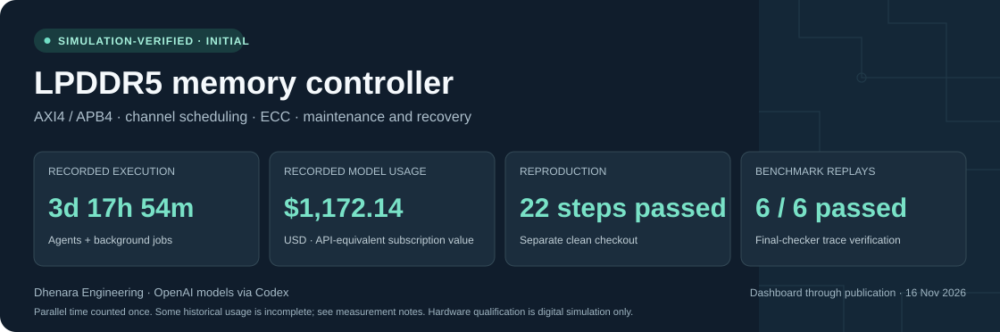
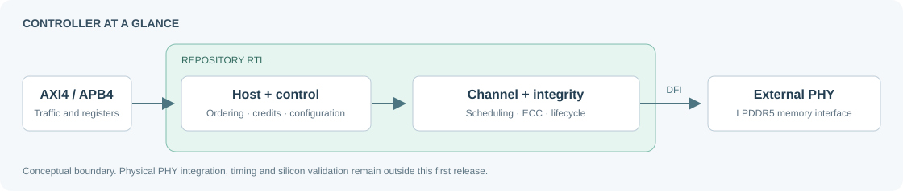
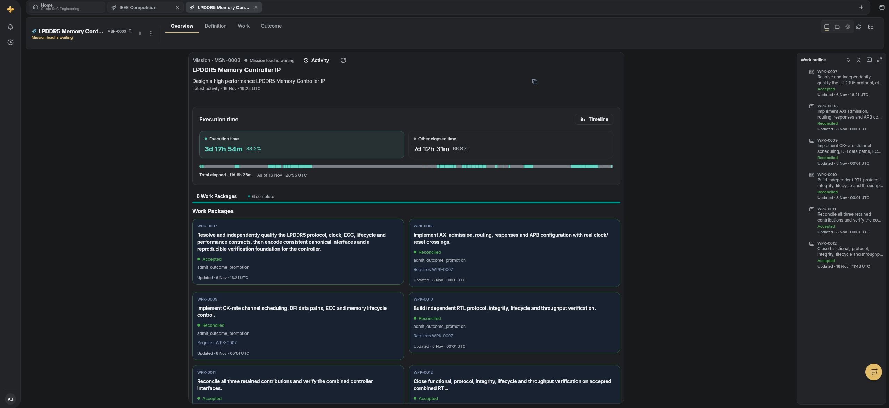
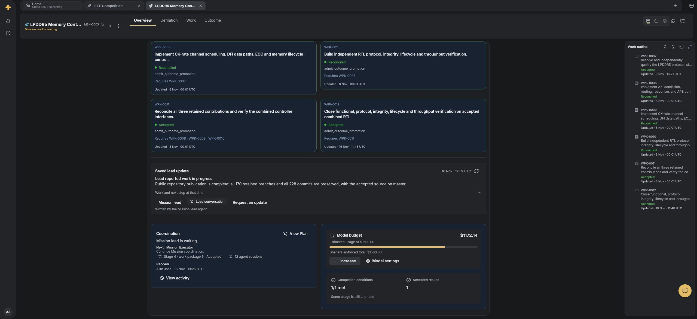
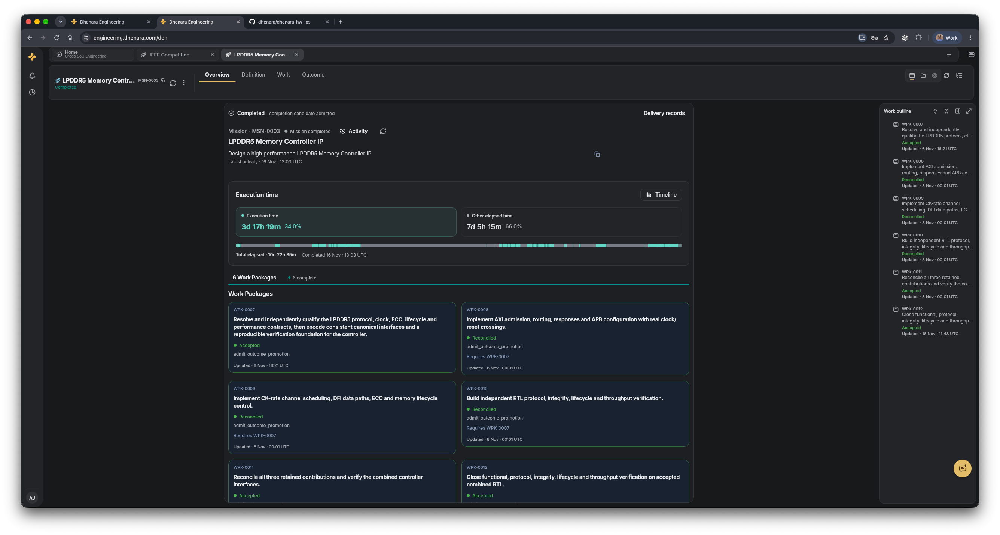

# Dhenara Hardware IPs

Open-source hardware development, with the source and verification evidence kept together.

The first IP in this repository is an **LPDDR5 memory controller**: AXI4/APB4 interfaces, channel scheduling, inline and link ECC, refresh, power management and recovery, developed and simulation-verified using **Dhenara Engineering**.



[Explore the controller](ips/lpddr5_mc/README.md) · [Read the final verification report](ips/lpddr5_mc/docs/verification/releases/initial/README.md) · [Browse the RTL](ips/lpddr5_mc/rtl/)

## LPDDR5: the first release

This is a technology-independent controller implementation with reproducible digital simulation evidence. The initial release was accepted on **16 November 2026**, at source [`ba8f514`](https://github.com/dhenara/dhenara-hw-ips/commit/ba8f5142fd9f76809a78badfd2a7c06736e2f187). The published merge [`f324c09`](https://github.com/dhenara/dhenara-hw-ips/commit/f324c093dba01debfc393744301e4d2fd18805aa) preserves that source with an identical file tree.

| Area | What is included |
| --- | --- |
| Host and control | AXI4 traffic, APB4 registers, ordering, backpressure and clock/reset boundaries |
| Memory channels | Scheduling, restricted LPDDR5/DFI digital profiles, refresh and maintenance |
| Data integrity | Inline ECC, link ECC, correction-triggered scrub and selected fault/recovery checks |
| Lifecycle | Power-down, self-refresh, frequency-set-point management and destructive recovery |
| Verification | Owning tests, connected-controller simulation, independent trace checkers and source-bound reports |



The [controller guide](ips/lpddr5_mc/README.md) describes supported configurations and integration entry points. The [implemented architecture](ips/lpddr5_mc/docs/architecture/implementation.md) documents the actual design.

## What was verified

**All eight first-release acceptance checks passed.** The final review records **22 passing reproduction steps** from a separate clean checkout, an independent **394-test integration pass on the accepted source**, and **six passing final-checker benchmark replays**. The six underlying HDL benchmarks each ran 100 periods, discarded ten warm-up periods and measured 90 complete periods, without tail-drain credit. Replaying those traces with the final checker did not rerun the benchmark HDL simulations.

| Scheduler selection | Read throughput | Write throughput |
| --- | ---: | ---: |
| CK | 12.8000 GB/s | 12.7926 GB/s |
| CK/2 | 12.8000 GB/s | 12.7936 GB/s |
| CK/4 | 12.8000 GB/s | 12.7918 GB/s |

These are bounded simulation measurements for the documented two-channel, one-rank-per-channel, plain-data workload with two 128-bit AXI ports at 400 MHz. CK is 800 MHz. CK/2 and CK/4 identify scheduler selection intervals; the engine still runs at CK. The reference is 12.8 GB/s for CK and CK/2, and 11.5712 GB/s for CK/4. All six meet the accepted 99% threshold. Other configurations, ECC modes and workloads do not inherit these throughput figures.

This release completes the accepted simulation qualification for the documented digital profiles. The [final verification report](ips/lpddr5_mc/docs/verification/releases/initial/README.md) maps the requirements to results, reviews and source revisions. Physical implementation, vendor-PHY integration and silicon qualification are the next engineering stages.

## Built with Dhenara Engineering

Dhenara Engineering coordinated the work from specification and implementation through regression, independent review and accepted delivery, using **OpenAI GPT-6 Astra and GPT-6.1 SOL through Codex**. The useful output is the controller, its development history and the evidence behind its claims. Human scope decisions and platform recovery were also part of this project.

The dashboard snapshot through publication on **16 November 2026** records **3 days, 17 hours and 54 minutes of execution time** and **US$1,172.14 in recorded model usage**. Execution counts intervals when agents or background jobs were running; simultaneous work counts once. It includes publication work following the initial acceptance, and is distinct from the total calendar time, which also includes waits, interruptions and other intervals.

Recorded model usage is the **API-equivalent value of subscription usage**, not a cash bill or total engineering cost. The configured budget limit is **US$1,500**. Some historical usage is incomplete; the [measurement notes](ips/lpddr5_mc/docs/verification/releases/initial/run-metrics.md) explain the scope, model breakdown and remaining accounting gaps. Infrastructure and human effort are outside this model-usage figure. No cost or speed improvement over another workflow has been measured here.

<details>
<summary>View the dashboard snapshot through publication</summary>





These unaltered views show the same Mission after publication on 16 November 2026. The accepted initial result remains in its history; the Mission can continue with further work.

</details>

<details>
<summary>View the original completed-Mission snapshot</summary>



The snapshot records the first completed version, before the Mission was continued for publication and additional work.

</details>

## Evidence that travels with the source

Start with the [final verification report](ips/lpddr5_mc/docs/verification/releases/initial/README.md): it brings the accepted scope, requirement-to-result table, independent review, benchmark results and reproduction evidence together. The [qualification ledger](ips/lpddr5_mc/docs/verification/qualification.md) preserves the detailed development and correction history.

The [initial GitHub Release](https://github.com/dhenara/dhenara-hw-ips/releases/tag/lpddr5-initial-2026-11-16) contains the original final evidence archive, independent review checks and earlier supporting qualification packages. The report links the original records and checksums so readers can inspect the evidence without a private workspace or Mission account.

## Run the checks

The current checkout exposes the controller suite through ordinary Make targets. From the repository root, use Linux amd64, Python 3.13.18, pip, dpkg-deb, GCC/G++ and GNU Make:

```sh
make prepare
make regress
```

Each run gets a fresh build name and an evidence directory beneath `ips/lpddr5_mc/evidence/`. Set `ARTIFACT_DIR` to a new absolute directory to write results elsewhere. For a focused check use `make regress SUITE=connected STEPS=controller`. Read `report.json` for the selected steps and source revision. Each selected step also has a `<step>/step.json` outcome, including when it timed out or could not run. Set `DHENARA_AGENT_TOOL_STORAGE_ROOT` to an absolute writable directory before both commands when tools and compiler output should live outside the checkout.

### Reproduce the initial release

The initial release reproduction recipe requires **Linux amd64 and Python 3.13.18**, with `pip`, `dpkg-deb`, GCC/G++ and Make already available. The reference checks enforce that Python version. The recorded final run used GCC/G++ 12.2.0 and Make 4.3. `make prepare` downloads and checksum-verifies Verilator 5.006, extracts it without system privileges, and installs the pinned Ruff utility into local tool storage; it does not install Python or the system compiler. See the [preparation script](ips/lpddr5_mc/tools/prepare_tools.py) and [verification guide](ips/lpddr5_mc/docs/verification/system.md).

`DHENARA_AGENT_TOOL_STORAGE_ROOT` is simply an absolute local directory for tools, caches and build outputs. These commands do not require a Dhenara account, an OpenAI API key or an agent session. Use a fresh evidence directory and build name for each run.

```sh
git clone https://github.com/dhenara/dhenara-hw-ips.git
cd dhenara-hw-ips
git checkout --detach ba8f5142fd9f76809a78badfd2a7c06736e2f187

# Create a fresh absolute local directory for verification tools and builds.
export DHENARA_AGENT_TOOL_STORAGE_ROOT="$(mktemp -d /tmp/lpddr5-tools.XXXXXX)"
make -f ips/lpddr5_mc/Makefile prepare
make -f ips/lpddr5_mc/Makefile check-controller \
  EVIDENCE="$PWD/ips/lpddr5_mc/evidence/initial-reproduction-01" \
  BUILD_SUBDIR=initial-reproduction-01 \
  CHECK_ARGS=--require-clean
```

`prepare` installs the local tools; `check-controller` compiles and runs the 22-step public owning and representative connected suite, saving reports and logs under the evidence directory. It checks that the source stays unchanged. The same suite passed in the retained Linux environment; a fresh-machine setup has not yet been qualified. The recorded throughput figures additionally depend on their original benchmark traces and independent checker replays. Running this suite does not reproduce every historical qualification result.

## Repository and next steps

Each IP keeps its RTL, specifications, verification, constraints and software under `ips/<ip_name>/`. See the [repository conventions](docs/development/repository-layout.md) and [contributing guide](CONTRIBUTING.md).

The next engineering stage is synthesis and physical-design exploration with open-source tools, followed by measured PPA and further qualification. Those results will be reported separately against their own source revisions and tool configurations.

**License:** [Apache License 2.0](LICENSE). Commercial use and modification are welcome under its terms. See [NOTICE](NOTICE) for attribution.
