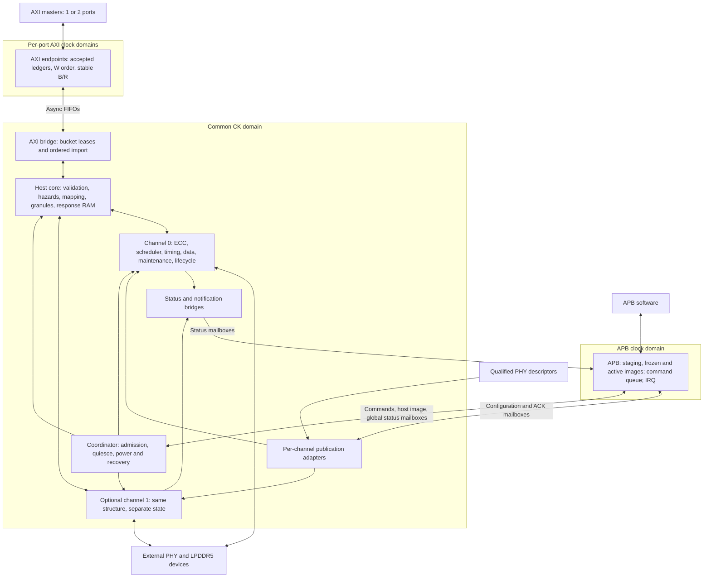
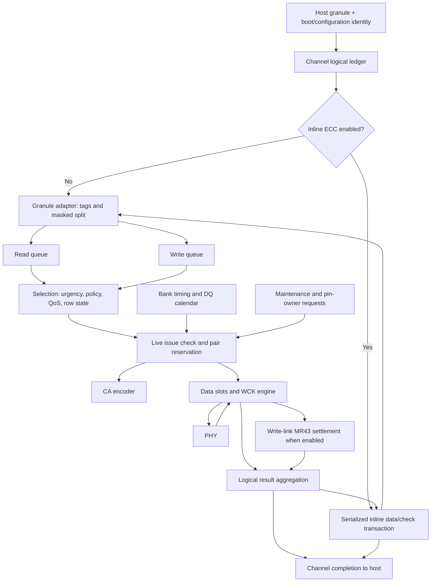
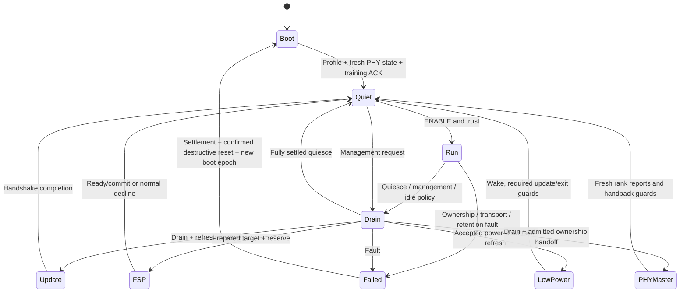

# LPDDR5 controller: implemented microarchitecture

**Implementation revision:** `98e8ca41879eae9c2f1754ef6c5a1c94f8dc7da7`

**Source tree:** `dhenara-hw-ips/ips/lpddr5_mc`

**Top-level module:** `rtl/integration/lpddr5_mc.sv`

**Review date:** 2026-11-12

This specification describes the RTL at the revision above. It is an implementation review document, with source references throughout. It preserves the distinction between logic present in the source, options reachable through the integrated wrapper, and behavior qualified by simulation. Full controller qualification and physical implementation remain incomplete. The imported v0.1/v0.2 specifications are historical design inputs and are not rewritten by this document.

All source paths below are relative to `ips/lpddr5_mc` at the recorded revision. Six diagrams use Mermaid; an ASCII overview is also included for Markdown viewers without Mermaid support.

**Review navigation:** [Interfaces](#1-external-interfaces) · [Clocks and reset](#2-clocks-rates-and-reset-domains) · [Features and configuration](#3-architectural-features-and-parameterization) · [Block organization](#4-top-level-organization) · [Host path](#5-host-admission-ordering-and-data-flow) · [Scheduler](#6-channel-request-path-and-scheduler) · [Data/WCK](#7-physical-data-and-wck-machinery) · [ECC](#8-integrity-paths) · [Maintenance](#9-maintenance-and-shared-pin-ownership) · [Control transitions](#10-configuration-publication-and-operating-transitions) · [Recovery](#11-fault-containment-recovery-and-diagnostics) · [Storage](#12-storage-concurrency-and-implementation-cost) · [Evidence limits](#13-evidence-and-current-review-limits) · [Source navigation](#14-source-navigation).

## 1. External interfaces

### 1.1 Interface inventory

| Interface | Top-level signals / types | Width and multiplicity | Implementation contract |
| --- | --- | --- | --- |
| AXI4 slave request/response ports | `aw_*`, `ar_*`, `w_*`, `b_*`, `r_*`; `lpddr5_mc_axi_address_t`, `lpddr5_mc_axi_write_t`, `lpddr5_mc_axi_b_t`, `lpddr5_mc_axi_read_t` | One or two ports; configured data width 64/128/256 bits; configured address width 32–40 bits; configured ID width 4–16 bits | Five independent AXI channels per port. Each port has its own clock/reset and an acceptance ledger. No ACE/coherency interface or exclusive monitor. |
| APB4 configuration and status | `pclk_i`, `psel_i`, `penable_i`, `apb_i`, `pready_o`, `apb_o` | 18-bit byte address, 32-bit data, four byte strobes, three protection bits, error response | Shared control window plus one window per channel. Staging writes and explicit publication; an APB write does not directly change running channel timing. |
| Interrupt | `irq_o` | One aggregate output | Masked OR of 13 sticky event bits, with channel-local error details and counters. Owned in the APB domain. |
| PHY command/address | `ca_o[channel]`, `lpddr5_mc_ca_t` | 14 CA bits and two rank-select bits per channel | One packed rise/fall CA word per CK: low seven bits for rising edge, high seven for falling edge. Rank selection is a positive one-hot mask in this generic interface. |
| PHY write data | `write_o[channel]`, `lpddr5_mc_write_bus4_t` | Four 32-bit words, four mask bits/word, two byte-slice enables/word, two rank-select bits/word, four raw parity bits/word | At ratio four all four word positions participate; ratio two uses the lower two. Continuous data CS includes split-burst gaps. |
| PHY read request | `read_request_o[channel]`, `lpddr5_mc_read_request4_t` | Four word positions × two byte-slice enables; two rank-select bits for each word/slice | Specifies return-enable timing independently of CS hold timing. |
| PHY read return | `return_i[channel]`, `lpddr5_mc_return4_t` | Four 32-bit words; independent valid for two byte slices per word; four DNV bits and four raw parity bits/word | Untagged physical return bus. The controller reconstructs ownership from its issued-command timing and per-slice word rotation. DNV consumes the returned word and marks failure. |
| PHY WCK control | `wck_o[channel]`, `lpddr5_mc_wck4_t` | Four phases × two byte slices; enable, two-bit rank select and two-bit toggle encoding | Parallel PHY controls, not a WCK clock output from RTL. Encodings select static, half-rate and full-rate toggling. |
| PHY management | `management_i[channel]`, `management_o[channel]` | One structured interface per channel | Initialization/FSP handshakes, controller/PHY updates, low-power handshake, PHY-master ownership, frequency/ratio/FSP, profile epoch and error input. |
| Rank-state and refresh attestations | `rank_report_valid_i`, `rank_self_refresh_i`, `phy_refresh_done_i` | Two rank bits per instantiated channel | External evidence of actual PHY-owned rank state and refresh execution. Unpopulated ranks are ignored by the admitted profile. |
| Qualified profile descriptors | `qualified_profiles_i[2:0]` | Three complete typed PHY descriptors, shared as inputs to the channel decoders | Integration-provided path/capability information, stable for a complete boot. Software timing/MR fields must form an admitted profile when combined with these descriptors. |
| Fault and destructive recovery | `external_fault_i`, `destructive_reset_request_o`, `destructive_reset_confirmed_i[channel]` | Global fault/request; confirmation per channel | Recovery requires completed host settlement and a fresh confirmation from the external reset owner. |
| Direct status | `enabled_o`, `fault_o`, `host_settled_o`, `status_o[channel]` | Global flags plus typed channel status | CK-domain integration/debug outputs. APB sees coherent crossed snapshots, not direct sampling of this bus. |

The AXI payload structs have fixed maximum storage widths: 40-bit address, 16-bit ID, 256-bit data and 32 strobes. `DATA_BITS`, `ID_BITS` and `ADDRESS_BITS` constrain the usable interface. Integrators must connect/zero unused high lanes appropriately; unsupported high address/ID values are rejected rather than silently truncated. The struct ports are the delivered interface; a flat signal wrapper is not instantiated here.

`AxCACHE` and `AxPROT` are carried in the address record but do not select a cache/coherency policy or security firewall in this implementation. `AxQOS` is mapped through the programmable QoS table. `AxLOCK` performs an ordinary access and never returns EXOKAY. The APB request carries protection bits, but they do not enforce a privilege policy.

**Source:** `rtl/integration/lpddr5_mc.sv`; `rtl/contracts/lpddr5_mc_contract_pkg.sv`; `rtl/host/lpddr5_mc_host_pkg.sv`; `rtl/control/lpddr5_mc_apb.sv`.

### 1.2 PHY management payloads

Each channel has the following fields in its management structs. All are CK-domain interface signals; the PHY adapter owns any further crossing.

| Direction | Fields | Purpose |
| --- | --- | --- |
| Controller to PHY | `ctrlupd_req`, `phyupd_ack` | Controller-requested and PHY-requested update handshakes |
| Controller to PHY | `init_start`, `frequency_ratio[1:0]`, `frequency[4:0]`, `fsp[1:0]`, `profile_epoch[31:0]` | Initialization/FSP request and exact operating-point identity |
| Controller to PHY | `phymstr_ack`, `syscs_state[1:0]`, `refresh_request[1:0]` | PHY-master ownership, rank state and external refresh request |
| Controller to PHY | `lp_ctrl_req`, `lp_data_req` | Low-power control/data handshakes |
| PHY to controller | `ctrlupd_ack`, `phyupd_req`, `phyupd_type[1:0]` | Update acceptance/request and type |
| PHY to controller | `init_complete`, `boot_state[1:0]`, `training_epoch[31:0]` | Initialization completion, boot state and training identity |
| PHY to controller | `phymstr_req`, `phymstr_type[1:0]`, `phymstr_cs_state[1:0]`, `phymstr_state_sel` | Master-ownership request and rank-state selection |
| PHY to controller | `lp_ctrl_ack`, `lp_data_ack`, `error` | Low-power acknowledgement and PHY error |

The separate rank-report, refresh-completion and destructive-reset-confirmation ports in the interface inventory remain required; these management fields do not replace them.

### 1.3 PHY boundary

The channel exposes a restricted generic DFI-style parallel interface for an external LPDDR5 PHY. Serialization, analog I/O, CK/WCK generation, training algorithms and external destructive reset execution are outside this RTL. Raw link-parity transport and explicit rank-state/refresh attestations are additional integration requirements. A vendor PHY needs an adapter and qualification against the numeric path, timing and ownership contract; the generic signal types alone do not establish interoperability.

## 2. Clocks, rates and reset domains

| Domain / quantity | Implemented arrangement | Recorded numeric point |
| --- | --- | --- |
| `clk_ck_i` | One shared clock for the host core, coordinator and all channel engines in `lpddr5_mc` | CK/DFI = 800 MHz, period 1.25 ns, in all admitted numeric fixtures |
| `axi_clk_i[p]` | Independent clock for each AXI endpoint; asynchronous FIFO crossings to CK | Benchmark: 400 MHz per port. The general connected fixture uses 400 MHz for port 0 and approximately 285.714 MHz for port 1 |
| `pclk_i` | Independent APB domain with bundled mailboxes to/from CK | Connected fixture: period 7 ns, approximately 142.857 MHz. This is a fixture setting, not an RTL maximum-frequency claim |
| New scheduler selection | CK-domain enable, controlled by `service_div = 1, 2, 4` | Selection opportunities at 800/400/200 MHz equivalent cadence |
| DRAM WCK, ratio four | Generated by external PHY from phase controls | 3200 MHz WCK, 6400 MT/s per pin |
| DRAM WCK, ratio two | Generated by external PHY from phase controls | 1600 MHz WCK, 3200 MT/s per pin |
| Internal timing units | DRAM/management timers in CK; DFI data timing fields in WCK; pin paths in half-WCK | One CK = eight half-WCK units at ratio four, four at ratio two |

**The two channels are logically separate but are not independently clocked in this top-level module.** Both use the same `clk_ck_i`. The reusable `lpddr5_mc_host_channel_link` exists for a separately clocked composition, but `lpddr5_mc_datapath` directly wires host and channels in CK and does not instantiate that link.

`service_div` does not divide the engine clock or change DFI:WCK ratio. Timing counters, maintenance and accepted two-command pairs advance on every CK. An accepted ACT pair or synchronization/access pair completes on the next CK even in CK/4 selection mode.

These frequencies describe the simulation/profile contract. No maximum silicon frequency, clock-tree implementation or timing closure is established. There is no PLL or clock divider in this controller.

For bandwidth context, x16 at 6400 MT/s has a raw pin ceiling of **12.8 GB/s per channel**, or **25.6 GB/s for two channels**. At 3200 MT/s those figures halve. Two AXI128 ports at 400 MHz offer **12.8 GB/s combined per direction** before stalls. These are bus-width/rate calculations, before refresh, turnaround, split gaps and integrity traffic; read and write share the memory data pins. They are not sustained-performance guarantees.

### 2.1 Reset ownership

- `rst_ni` asynchronously asserts common operational reset; release is synchronized separately to CK and APB.
- Each `axi_rst_ni[p]` owns that port's acceptance ledger. A remote/core reset must not silently discard transactions already accepted by a surviving AXI interface.
- Cold reset is derived from the common reset and **all** AXI resets being asserted together. Its release is synchronized to each relevant domain. Boot epochs, fault-observation history and retained diagnostic transport use this longer-lived reset boundary.
- Either endpoint reset aborts a CDC transport and leaves it fenced. Both sides must explicitly rearm after the actual transport reset-release witnesses, settlement and epoch checks. Reset deassertion by itself does not authorize traffic.
- Common operational reset invalidates configuration and trust. If an AXI ledger survives, it must settle outstanding responses before destructive recovery, a greater boot epoch and fresh publication/training permit service.

**Source:** `rtl/integration/lpddr5_mc.sv`; `rtl/integration/lpddr5_mc_datapath.sv`; `rtl/host/lpddr5_mc_host.sv`; `rtl/cdc/`; `dv/integration/controller_tb.sv`; `config/contracts/profiles.json`.

## 3. Architectural features and parameterization

### 3.1 Top-level elaboration parameters

| Parameter | Default | Source-admitted values / role |
| --- | ---: | --- |
| `PORTS` | 2 | 1 or 2 independent AXI interfaces |
| `CHANNELS` | 2 | 1 or 2 x16 memory channels |
| `RANKS` | 1 | 1 or 2 populated 8 Gb x16 ranks per channel; common elaboration choice |
| `DATA_BITS` | 128 | 64, 128 or 256 active AXI data bits |
| `ID_BITS` | 8 | 4–16 active AXI ID bits |
| `ADDRESS_BITS` | 40 | 32–40 active AXI address bits |
| `DEPTH` | 64 | 16, 32 or 64; controls source transaction credits and multiple host/channel storage structures |
| `PER_BANK_REFRESH` | 0 | Fixed elaboration policy: 0 selects all-bank refresh; 1 permits paired per-bank rounds when the maintenance budget can accommodate them |
| `PUBLICATION_TIMEOUT` | 65536 | APB cycles allowed for publication progress before the failure/abort path |

This table describes accepted RTL settings, not a claim that every Cartesian combination has completed qualification. The software example selects 16 ID bits, while the top-level default is eight; the example is not the elaboration default.

Lower-level knobs are not all top-level options. The wrapper fixes `POSTED_EARLY=0` and `EXTERNAL_ABORT_LEDGER=1`; channel notification depth stays at its lower-level default of 16. APB command depth is eight. The coordinator's command timeout is 65536 CK and is not exposed as a top-level parameter. Changing a submodule parameter in isolation does not demonstrate a supported wrapper configuration.

### 3.2 Feature inventory

| Area | Implemented mechanism | Important boundary |
| --- | --- | --- |
| AXI burst handling | FIXED up to 16 beats; INCR up to 256; WRAP lengths 2/4/8/16; legal narrow and unaligned accesses; byte strobes | Rejects reserved burst encodings, illegal widths/IDs, address overflow, 4 KiB crossings and unmapped bytes |
| Host concurrency | Separate read/write slots per port; complete write buffering; retained read/response storage; multiple disjoint transactions in flight | One pending memory granule per host transaction; no cross-transaction write merging or read forwarding datapath |
| Ordering | Source-side bucket leases plus ordered import; byte-range hazards in host core; per-direction response order per port | Stronger response order than AXI requires; overlapping unfinished work is serialized |
| Address mapping | Eight regions, programmable bit permutations, 64-byte two-channel striping, sequential rank allocation | Restricted 8 Gb x16 geometry and injective mapping; low six address bits preserved |
| Burst conversion | 32/64-byte logical granules; BL16/BL32 physical access; masked BL32 split into two MWR16 operations | Fully validated W count precedes any write effect |
| Channel scheduling | Separate direction queues; row/timing state; QoS classes, aging, batches, watermarks, hit cap, idle closure, live issue recheck | Priority never bypasses timing, hazards, capacity, maintenance or byte caps |
| PHY timing | CK-rate CA, per-word/per-slice data timing, DQ reservation, WCK synchronization and stop/restart | Only admitted numeric PHY fixtures; zero read/write data-CS gaps |
| Integrity | Inline SECDED64+8, read/write link ECC, DBI/data-mask handling, correction-triggered scrub, bounded poison tracking | Inline path serializes one protected operation per channel; raw parity required for link ECC |
| Retention and maintenance | REFab, optional REFpb rounds, mandatory paired-bank RFM, MR4 thermal polling, background ZQ latch | Actual emitted service discharges obligations; unsupported thermal/capability values fail closed |
| Management | Boot/training gate, quiesce, PHY updates, normal power-down, self-refresh, FSP change, PHY-master handoff | PHY algorithms and external state attestations are required inputs |
| Recovery | Stop admission, settle accepted AXI work, confirm destructive reset, advance boot epoch, republish/retrain | IRQ clear or elapsed time cannot restore memory trust |
| Observability | Event queue, first-error detail, CE/UE counts, coherent status and explicit performance capture | Diagnostics do not replace external protocol/data checks |

### 3.3 Runtime configuration actually consumed

Configuration is staged in APB and installed as a coherent image. Channel-local settings can differ where the shared host map and admitted profile permit it.

| Configuration | Effective implementation |
| --- | --- |
| `MODE.BURST64` | Selects 32- or 64-byte host granule formation |
| `MODE.INLINE_ECC` | Selects inline integrity path and reduced usable rank capacity; enabled region attributes must agree |
| `MODE.LINK_READ`, `MODE.LINK_WRITE` | Must match the admitted selected PHY profile |
| `MODE.POSTED_B` | Retained in the host configuration, but integrated completion remains conservative: final integrity precedes OKAY |
| `MODE.SERVICE_DIV` | New scheduler selection every 1/2/4 CK |
| `QOS_MAP` | Maps all 16 AXI QoS encodings to four internal classes |
| `PORT_LIMIT_0/1` | Independent per-port read/write outstanding limits, each bounded by `DEPTH`; zero blocks that direction's admission |
| Region base/size/attributes/bit map | Eight enabled, nonoverlapping, power-of-two regions; base aligned to 4 KiB; permutation and capacity validation |
| `SCHED_RD_AGE`, `SCHED_WR_AGE`, `AGE_TICK_DIV` | Saturating 16-bit ages increment by one each programmed CK tick; per-direction urgent thresholds |
| `RD_WEIGHT`, `WR_WEIGHT`, batch minima/maxima, `WR_HIGH/LOW` | Direction policy and write-turn scheduling; urgency can escape a zero nonurgent weight |
| `HIT_CAP`, `PAGE_IDLE` | Limits repeated row hits in favor of a waiting miss; closes idle pages in otherwise unused legal slots; zero disables each policy |
| `BW_WINDOW`, `RD_CAP`, `WR_CAP`, `BW_MODE` | Fixed CK windows; strict or work-conserving byte accounting; integrated caps are always enabled; zero cap disables that direction |
| `FSP_VALID`, `DVFS` target and three FSP banks | Select a complete admitted timing/MR profile; a changed profile requires actual FSP readiness before common commit |
| `FSPn_TRTW` | Additional read-command-to-write minimum; physical recovery also applies |
| `PM_REQUEST`, `PD_IDLE`, `SR_IDLE` | Automatic idle policy: 0 off, 1 power-down, 2 self-refresh, with nonzero idle threshold |
| IRQ mask / W1C status / performance snapshot | Interrupt presentation, local diagnostic clear and explicit stable performance capture |

Several exposed fields need special treatment during review:

- `AGE_STEP` is writable in the schema, but APB image admission requires **exactly 1**. Its reset value is 256, so the reset image is not publishable without programming this field and the required profile/map settings.
- `BW_BURST`, `WCK_IDLE`, `TEMP_POLL` and `ZQ_INTERVAL` have register storage but no runtime consumer in the inspected channel decoder/RTL. They do not program a token-bucket burst limit, WCK idle timeout or polling interval here. Maintenance uses its implemented 3000-CK MR4/ZQ deadline policy; WCK follows actual transfer/profile timing.
- APB composition fixes `page_policy=0` (open page plus idle/max-row closure). The standalone typed channel has an auto-precharge path for `page_policy==1`; no APB page-policy selector enables it in this wrapper.
- `CONTROL.INIT` does not execute PHY training or manufacture a valid boot attestation. The coordinator checks its state; actual boot readiness still comes from the PHY and the training acknowledgement.

**Source:** `rtl/contracts/lpddr5_mc_contract_pkg.sv::lpddr5_mc_parameters_valid`; `rtl/host/lpddr5_mc_host_core.sv`; `rtl/integration/lpddr5_mc_channel_register_decode.sv`; `rtl/control/lpddr5_mc_apb.sv::image_valid`; `config/contracts/registers.json`.

### 3.4 Admitted PHY and DRAM profiles

There are 32 explicit digital fixtures in `config/contracts/profiles.json`. They combine the allowed link, DBI and always-on options within two rate families. `profile_valid()` compares the entire profile against `fixture_profile()` with explicit allowances for rank count and discovered capabilities; programming arbitrary timing values is not supported merely because timing CSRs exist.

| Family | WCK:CK | Organization | Base RL / WL | Restrictions |
| --- | ---: | --- | --- | --- |
| LPDDR5-6400 | 4 | BG, x16, 8 Gb/rank | 17 / 9 CK without read link; 19 / 9 with read link | Read DBI adds one CK when read link is off; read link and read DBI cannot coexist |
| LPDDR5-3200 | 2 | 16-bank, x16, 8 Gb/rank | 18 / 10 CK | Link ECC disabled; read DBI adds two CK |

Both use CK=800 MHz. Profiles include full MR images, RL/WL/nWR, WCK enable/postamble/disable times, DFI word timing, half-WCK path offsets and management/DRAM guards. Read/write link ECC requires ratio four, raw parity transport and the corresponding discovered device capability. Nonzero `tphy_wrcsgap` or `tphy_rdcsgap` rejects admission. MR8 remains the restricted 8 Gb x16 geometry; admitted MR27/MR57 variants govern mandatory paired-bank RFM independently of timing.

Three FSP descriptors do not imply three unrelated CK frequencies: this implementation's FSP engine retains CK at 800 MHz and uses frequency code 0 for ratio two and 1 for ratio four.

## 4. Top-level organization



ASCII overview:

```text
AXI clocks                 common CK                             external
AXI -> endpoint <-> CDC <-> bridge/host core -> channel 0 <------> PHY/DRAM
                            |                -> channel 1 <------> PHY/DRAM
                            |                     ^
APB clock                   v                     |
APB -> staging/publication <-> mailboxes <-> coordinator/channel control
       IRQ/error/status    <---------------- notifications/snapshots
```

The shared host selects a channel after address mapping. Each channel owns its bank state, physical queues, DQ/WCK schedule, integrity and maintenance. The coordinator is a global admission/recovery boundary: a channel fault can stop the entire wrapper. Logical channel independence does not imply independent failover or independent reconfiguration while traffic runs.

### 4.1 Instantiated logical blocks

| Block | Owning module(s) | Main state and responsibility |
| --- | --- | --- |
| Top-level composition | `lpddr5_mc`, `lpddr5_mc_datapath` | Resets, typed wiring, common CK datapath and APB/AXI crossings |
| AXI source boundary | `lpddr5_mc_axi_endpoint` | Per-port read/write ledger, generations, W order, stable response exposure and actual handshakes |
| Cross-port admission | `lpddr5_mc_axi_bridge` | Exclusive bucket ownership, revoke/grant protocol, source import watermarks |
| Host execution | `lpddr5_mc_host_core` | Transaction descriptors, whole-write buffer, hazards, map/granule formation, read assembly and retirement |
| APB/control | `lpddr5_mc_apb`, `lpddr5_mc_control_link`, `lpddr5_mc_coordinator` | Staging/publication, coherent transport, admission, sleep/wake and recovery |
| Channel publication | `lpddr5_mc_channel_control`, `lpddr5_mc_channel_register_decode`, `lpddr5_mc_channel_config` | Decode/check/freeze configuration, FSP readiness, prepare/commit acknowledgement |
| Channel composition | `lpddr5_mc_channel` | Logical ledger, ECC selection, lifecycle/maintenance arbitration and status |
| Logical-to-physical conversion | `lpddr5_mc_granule_adapter` | Internal tags, masked BL32 splitting, result aggregation |
| Physical scheduling | `lpddr5_mc_backend`, `lpddr5_mc_scheduler` | Pin-owner arbitration, read/write queues, page/timing state, DQ reservations and CA issue |
| Data and WCK | `lpddr5_mc_data`, `lpddr5_mc_wck` | Physical transfer ownership, word/slice return matching, ECC/DBI transforms, synchronization timing |
| Inline ECC | `lpddr5_mc_inline`, `lpddr5_mc_ecc_pkg` | Serialized data/check update, decode/merge/scrub, poison tracking |
| Link write settlement | `lpddr5_mc_write_epochs` | Rank-local write membership until MR43 result |
| Maintenance/register service | `lpddr5_mc_maintenance`, `lpddr5_mc_register_io` | Retention, thermal/RFM, MR4/ZQ/MR43 and exclusive register pin use |
| Lifecycle/management | `lpddr5_mc_lifecycle`, `lpddr5_mc_update`, `lpddr5_mc_fsp` | Trust, ownership, training, low power, updates and frequency-point handoff |
| Diagnostics | `lpddr5_mc_notifications`, `lpddr5_mc_status_bridge` | Immutable occurrences, first-error capture and coherent snapshots |

## 5. Host admission, ordering and data flow

### 5.1 Acceptance before clock crossing

The authoritative acceptance event is the AXI AW/AR handshake in the source clock domain. Before asserting READY, the endpoint reserves a direction-specific slot, generation, response capacity, sequence number and acceptance-FIFO entry, and proves that it owns every bucket touched by the burst.

There are 64 exclusive logical 64-byte buckets indexed by address bits `[11:6]`. They are conservative ownership hashes, not address-range restrictions: addresses 4 KiB apart can collide and serialize. The admitted address permutation preserves the low six bits and is injective, so disjoint ownership proves that accepted operations on different ports do not overlap in memory. Invalid/unmapped bursts take all buckets rather than bypassing ordering.

A lease miss retains one immutable proposal. The bridge reserves new rights before granting them. On a conflict, it revokes complete masks from the sources holding rights, stops their new address acceptance, and waits for exact token/boot/configuration acknowledgements, imported sequence watermarks and retirement of already accepted transactions. W data, results and retirement continue during this drain. This makes source acceptance order meaningful even when the AXI clocks run at different rates.

AW and AR share a per-port sequence; AW wins a same-cycle tie. CK import must match the next sequence exactly. Cross-port import may commute only for operations whose lease ownership proves they are disjoint.

### 5.2 Burst validation and hazards

An accepted AW reserves its full conservative byte-range hazard immediately, including the period before any W arrives. W beats follow AW order. The core buffers and validates the complete admitted `AWLEN + 1` count before emitting a write granule. Early WLAST does not truncate the transaction; malformed WLAST/strobes return SLVERR after the admitted W count. Illegal address forms and mapping failures return DECERR without memory effects.

The host scans older transactions for overlapping byte ranges and blocks the younger operation while the older transaction lacks final integrity. This also serializes overlapping reads in the current implementation. Nonoverlapping transactions may progress concurrently.

Aligned, full-width INCR beats coalesce into a 32- or 64-byte granule. Other supported forms use a single beat's addressed byte range and lane strobes to construct a granule. Each transaction advances one chunk at a time; another chunk is formed after its prior physical/integrity result. This is within-burst coalescing, not merging of independent AXI writes.

**Source:** `rtl/host/lpddr5_mc_axi_endpoint.sv`; `rtl/host/lpddr5_mc_axi_bridge.sv`; `rtl/host/lpddr5_mc_axi_pkg.sv`; `rtl/host/lpddr5_mc_host_core.sv`.

### 5.3 Address translation

The mapping sequence in `decode_address()` is:

1. Select an enabled region containing the byte address.
2. Subtract the region base and apply its programmed bit permutation.
3. Add the sizes of all enabled regions with lower base addresses. Regions pack in ascending base order, independently of their CSR indices.
4. With two channels, use mapped bit 6 as the channel and remove that bit from the channel-local address. With one channel, retain the address unchanged.
5. Select rank by the channel-local usable rank capacity, then subtract that capacity for rank 1.
6. Decode the rank-local byte address: bank `[14:11]`, row `[29:15]`, column `[10:5]` in 32-byte units, and byte position `[4:0]`. The high row/column bits of the wider internal structs are zero.

A plain rank has 1,073,741,824 bytes. Inline ECC exposes `floor(1,073,741,824 / 576) × 512 = 954,437,120` data bytes per rank; the upper reserved area contains check bytes. Total mapped region capacity cannot exceed the selected channels/ranks' usable capacity. BL32 uses an even column index; a 32-byte logical operation selects its half with column bit 0.

### 5.4 Completion and response lifetime


Every channel result carries a 64-bit tag, 16-bit generation, 32-bit boot epoch and 32-bit configuration epoch, plus direction, physical/integrity flags, response and up to 512 data bits. The host ignores stale/mismatched completions for state/credit purposes and counts them. Completion projection between channel and host uses named fields, avoiding packed-layout dependence on extra ECC diagnostics.

Read chunks are assembled into the reserved host payload RAM. The current core waits until a transaction finishes before returning its R beats. B and R responses each follow admission order within a port, preserving same-ID ordering with stronger serialization across different IDs. Exposed B/R values stay stable under backpressure. Unexposed responses can be converted to errors on abort; an already exposed success cannot be changed and instead contributes late-error evidence where applicable.

Physical slots can be recycled once their remaining obligations have transferred to reserved host storage. Source transaction credit remains reserved until the real bus handshake and retirement protocol complete. This separates channel throughput from a stalled master's response latency.

## 6. Channel request path and scheduler



The ECC path and plain path are mutually selected; the arrows through inline ECC represent its physical subrequests and their returned results.

### 6.1 Logical ledger and physical tags

The channel reserves one of `DEPTH` logical ledger entries before admission. It retains caller identity and acceptance time until completion transfers to the host. Stale boot/configuration requests are consumed as stale work and are not issued to memory; legal host operation is expected to supply the active epochs.

The granule adapter assigns monotonically increasing internal physical tags. A masked 64-byte write is split into two independently tracked 32-byte masked writes with separate tags and columns. It aggregates physical completion, error and integrity status back to the original caller identity. Duplicate identities fault; exhausted tag spaces do not silently wrap.

### 6.2 Queue and bank state

The scheduler has `DEPTH` entries per direction. Each entry holds the full granule, an insertion order, acceptance CK and a saturating 16-bit age. It maintains storage for 32 banks: sixteen per possible rank. Per-bank state includes open row, ACT/PRE/access deadlines, open time, last access and masked-write history. Rank/group state includes tRRD, four-ACT window, column spacing, refresh recovery and direction-turnaround fences.

A 1024-half-WCK DQ reservation calendar prevents overlapping pin transfers, including the ratio-four BL32 split gap. It shifts by `2 × ratio` each CK. This is a timing occupancy calendar, not data storage.

The logical channel ledger and shared data-slot capacity bound total admitted work; two direction queues do not imply `2 × DEPTH` independently available end-to-end completions.

### 6.3 Selection and issue

A candidate needs ACT for a closed bank, PRE for a wrong open row, or ACCESS for a row hit. Older queued physical overlaps block younger entries. Selection checks predicted timing and caps before applying this preference order:

1. Urgent requests first; greater age, then older insertion order.
2. For nonurgent work: retained miss reservation, hit-cap-forced miss, preferred direction, higher QoS class, row hit, then older insertion order.
3. Direction weights, minimum/maximum batches and write occupancy watermarks constrain the nonurgent eligible set. A requested turnaround can hold the old direction while timing matures; empty, overlap-blocked or cap-disabled work cannot hold that turn indefinitely.

The selected proposal records queue slot, tag, generation and required operation. Before issue, the engine rechecks identity, row state, older overlaps, live timing, DQ availability, physical capacity and caps. Invalid proposals replay or are reselected. An ACCESS can remain pending between CK/2 or CK/4 selection opportunities and issue when legal. Accepted pairs have priority and complete on the next CK.

For a new row, ACT1/ACT2 is followed by tRCD before access. A changed row requires legal precharge and tRP first. A stopped WCK needs a synchronization CAS followed one CK later by the access. Reused synchronization is limited to the same rank/direction and its valid window. Rank/direction changes request stop and fresh synchronization.

The integrated policy is open-page. `HIT_CAP` reserves a waiting miss through PRE/ACT/access, preventing a stream of hits from repeatedly reopening the old row. `PAGE_IDLE` uses an otherwise unused legal CA slot. Maximum-row-active closure has higher priority and cannot wait for an idle opportunity.

### 6.4 Bandwidth caps and fairness

Caps count **physical issued bytes** in fixed windows derived from the channel CK counter. A 32/64-byte issue charges the corresponding direction by 32/64 bytes; internal inline-ECC reads/writes also traverse this owner. Strict mode must fit the direction cap. Work-conserving mode may borrow only with nonzero own cap, no eligible opposite-direction traffic and enough combined budget. A zero direction cap remains disabled.

Urgency does not override these constraints. The RTL contains age-based escape and timing-aware selection, but the promised conditional fairness bound additionally needs evidence for the actual eligible issue-gap bound and suspended intervals. That separate closure remains open; queue priority logic alone is not a proof of the bound.

**Source:** `rtl/channel/lpddr5_mc_channel.sv`; `rtl/channel/lpddr5_mc_granule_adapter.sv`; `rtl/channel/lpddr5_mc_scheduler.sv`; `rtl/channel/lpddr5_mc_backend.sv`.

## 7. Physical data and WCK machinery

`lpddr5_mc_data` reserves a slot before an access is launched. A slot holds command CK, identity, rank, direction, burst length, 512-bit data, DMI/parity and independent receive counts for both byte slices. Physical completion waits for every required word/slice and the final pin/path recovery boundary. Merely issuing a command does not complete it.

At ratio four, four 32-bit words are presented per CK. A 32-bit word represents two x16 transfers; each byte slice contributes 16 bits and has its own valid. BL16 has eight words; BL32 has sixteen. Ratio-four BL32 inserts eight data-clock word slots between the halves, so the data CS stays asserted over 24 slots while only sixteen carry words. Ratio two uses two word positions per CK.

The read return bus has no tag. The data owner chooses each byte slice's next expected word by enable time, checks the allowed return deadline, and advances its rotating valid-lane pointer. This permits split-gap interleaving between outstanding reads while retaining exact transfer ownership. Unexpected valid lanes, noncontiguous valid rotation, early/late/missing words and conflicting output ownership latch a data fault. DNV is a failed payload, not permission to skip a word.

The WCK engine tracks enable, static/half-rate/full-rate intervals, postamble, disable and reuse expiry. Normal mode ends according to the admitted synchronization window. Always-on mode continues until WS_OFF; stop waits for the true final pin postamble. WS_OFF uses an otherwise empty CA slot and cannot displace an accepted pair. New rank/direction use requires full stop and a fresh synchronization.

Register reads use a separate small data/WCK instance under an exclusive backend pin mux. The host data path and register path cannot own CA/WCK/read-return simultaneously.

**Source:** `rtl/channel/lpddr5_mc_data.sv`; `rtl/channel/lpddr5_mc_wck.sv`; `rtl/channel/lpddr5_mc_backend.sv`; `rtl/channel/lpddr5_mc_register_io.sv`.

## 8. Integrity paths

### 8.1 Inline ECC

Inline ECC uses SECDED64+8: one check byte per protected 64-bit word. One 64-byte check line covers 512 data bytes. Data occupies the lower usable rank range; check lines are addressed in the reserved upper range. The engine holds one logical operation per channel, so data and check-line updates are serialized without a separate multi-entry check cache or deferred scrub queue.


The implementation performs the initial check/data reads even for full writes; full protected words can bypass old-data ECC decoding so a complete rewrite can repair poison. Partial words require successful old-data correction before merge. Corrected reads perform data/check scrub under the same serialized ownership before allowing the next request.

A failed physical data/check update records poison for affected protected words in a bounded rank/word CAM of `DEPTH` entries. A successful rewrite clears corresponding poison. Exhausting poison storage faults closed. An uncorrectable logical operation returns an error without automatically inventing global ownership loss; the independent transport/ownership failure path remains available.

### 8.2 Link ECC and DBI

The ECC package implements 128-data-bit/9-check-bit link codewords and 16-data-bit/6-check-bit DMI codewords using the recorded parity matrices. The data path generates write parity and decodes read parity at the raw PHY boundary. DBI/mask transformations follow the selected admitted profile. Read link and read DBI are mutually excluded by admission.

For write link ECC, physical completion is followed by rank-local MR43 settlement. Each rank retains up to sixteen physical-write identities. The epoch closes on membership limit, explicit flush or the reserved poll deadline. The oldest ready rank epoch gets the shared register path after data drain, page recovery and WCK disable. Returned MR43 status settles every member; a bad/nonzero result fails that epoch's writes. Polling does not wait for logical completions that themselves depend on the poll.

The standalone epoch module has posted-notice/exposure machinery, but the integrated backend wires `posted_i=0` and disables that feedback input. The assembled host also fixes `POSTED_EARLY=0`. Thus programming `POSTED_B` does not create an early-success write response in this wrapper.

**Source:** `rtl/ecc/lpddr5_mc_ecc_pkg.sv`; `rtl/ecc/lpddr5_mc_inline.sv`; `rtl/channel/lpddr5_mc_data.sv`; `rtl/channel/lpddr5_mc_write_epochs.sv`; `rtl/channel/lpddr5_mc_backend.sv`.

## 9. Maintenance and shared pin ownership

The maintenance block owns per-rank retention timestamps, eight paired-bank row-activation counters per rank, refresh sequence, thermal state and the extra-refresh obligation after self-refresh exit. Scheduler issue events, rather than requested commands or queue removal, update these obligations.

| Thermal code | Implemented refresh interval |
| --- | ---: |
| 1–9 | 3124 CK |
| 10 | 2186 CK |
| 11 | 1562 CK |
| 12–13 | 781 CK |
| 14–15 | 390 CK |

Codes outside the supported range do not supply a legal interval. Codes 13 and 15 also tighten the effective row timings. Each MR4 sweep visits populated ranks and applies the hottest observation globally. A shortened interval exposes existing debt, blocks additional ACT traffic where needed and uses a bounded emergency-drain policy.

Default service uses REFab. With `PER_BANK_REFRESH=1`, all eight prescribed pair refreshes must complete before a round counts as periodic retention service. Rank rounds can interleave. When a complete pair-round plus drain/register allowance cannot fit the thermal interval, the engine falls back to REFab. RFM uses admitted MR27/MR57 counter thresholds/decrement rules and does not reset the periodic-refresh timestamp.

MR4 and background ZQ obligations use the implemented 3000-CK watchdog/deadline policy. Polling starts early enough to budget traffic drain, precharge, WCK shutdown and serialized register work. At the normal all-bank point, one REF group is pulled forward to share the MR4 drain; required refresh and MR4/ZQ guards remain separate. Hot/per-bank operation uses a more conservative reserve. Pending register service keeps its issue/drain fence across rank handoffs and refresh preemption.

The backend gives register service pins only after real physical drain, page recovery and WCK disable. MR43 can take precedence over periodic register work. MRR uses synchronization, a BL16 return with DBI/link disabled, command-origin recovery, postamble and complete WCK stop before handback. Background ZQ emits the latch operation and waits tZQLAT. Full-rank PREab also waits for banks already closed but still in precharge/auto-precharge recovery.

**Source:** `rtl/channel/lpddr5_mc_maintenance.sv`; `rtl/channel/lpddr5_mc_channel.sv`; `rtl/channel/lpddr5_mc_backend.sv`; `rtl/channel/lpddr5_mc_register_io.sv`; `rtl/channel/lpddr5_mc_channel_pkg.sv` budget functions.

## 10. Configuration publication and operating transitions

### 10.1 APB register organization

The APB address map has a shared window below `0x10000`, channel 0 at `0x10000 + offset`, and channel 1 at `0x20000 + offset`. Registers are 32-bit aligned. Byte strobes apply to RW, W1C and W1S fields. Undefined/unaligned accesses, writes to locked/RO registers and unsupported accesses return an APB error. The RTL validates every destination and command-queue requirement before mutating staging state. Broadcast channel writes originate through channel 0 when `CONTROL.BROADCAST` is set.

The exact field/offset source is `config/contracts/registers.json`; `docs/programming/registers.md`, generated SystemVerilog metadata and the C header derive from it. Those files remain the detailed register reference; this specification describes the consumers and state transitions.

### 10.2 Atomic publication

```mermaid
sequenceDiagram
  participant SW as APB software
  participant AP as APB publication owner
  participant CC as Channel control adapters
  participant CH as Channel configuration / FSP
  participant H as Coordinator and host
  SW->>H: Quiesce through control command
  H-->>AP: Host settled and channels drained
  SW->>AP: Stage image; CONFIG_COMMIT or DVFS GO
  AP->>AP: Validate, freeze, CRC32
  AP->>CC: PREPARE with boot/sequence/image
  CC->>CH: Validate typed profile and prepare
  opt Operating profile changes
    CC->>CH: Execute FSP transition
    CH-->>CC: Exact prepared epoch ready
  end
  CC-->>AP: PREPARE acknowledgements
  AP->>CC: COMMIT after all destinations ready
  CC->>CH: Commit exact frozen image
  CC-->>AP: COMMIT acknowledgements
  AP->>H: Coherent committed host image and epoch
  H->>H: Install configuration and rearm endpoints
  SW->>H: ENABLE
```

APB owns separate staging, frozen and active images. A whole-image reflected CRC32 checks transfer integrity; channel control validates the original register image and supplies a second CRC over its typed channel configuration. Prepare alone cannot activate a profile. Channels compare exact boot/configuration identities, CRC, frozen payload and actual drain again at commit.

A unanimous normal FSP decline can preserve a previously valid operating point and consume the attempted sequence. Mixed ready/decline outcomes, malformed acknowledgements or timeout invalidate admission and take the abort/fault path; rollback is not assumed. Host admission reopens only when the committed host image, every channel's installed epoch, training/trust and endpoint initialization agree.

### 10.3 Boot, run and low power



This is a grouped state diagram; the RTL has separate states for accept/release, residency, SR exit and recovery guards.

Boot requires a published admitted profile, an observed low-then-high PHY initialization completion, valid rank-state reports, matching training epoch and disabled WCK. Software supplies `TRAIN_TOKEN` for the current boot and acknowledges an outstanding training request. Boot exits any reported self-refresh state with the required guard before granting memory trust.

Before management or quiesce, the coordinator closes **new source admission**. Channel DRAIN still accepts/issues already accepted host work until the actual host settlement witness is true. Backend emptiness alone cannot prove that CDC queues contain no accepted work.

Automatic power policy uses global host-idle observation and selected channel thresholds. A pending AXI VALID becomes a synchronized wake request; software commands, publication or PHY management can also wake sleeping channels. Power-down/self-refresh require real drain and PHY acknowledgement. Self-refresh exit performs its controller update and exit guard; an extra refresh is required before later re-entry. Normal declines and malformed/late handshakes take distinct paths.

PHY-master ownership requires drained pins and explicit rank-state agreement. Fresh low-before-high rank reports and actual external refresh acknowledgements are checked on return. Timer expiry cannot establish that the PHY has returned ownership.

### 10.4 FSP changes

The engine freezes an inactive target profile and epoch before asserting the PHY initialization/frequency request. It checks a fresh PHY acceptance, writes MR16 FSP-WR, seventeen selected target MRs, then MR16 FSP-OP. It waits the long FSP guard (at least 201 CK), six running CK, registered request release and a later PHY completion. Only then is the target ready for common publication. CK remains constant; the external PHY owns the actual rate/ratio change.

**Source:** `rtl/control/lpddr5_mc_apb.sv`; `rtl/integration/lpddr5_mc_channel_control.sv`; `rtl/channel/lpddr5_mc_channel_config.sv`; `rtl/integration/lpddr5_mc_coordinator.sv`; `rtl/channel/lpddr5_mc_lifecycle.sv`; `rtl/channel/lpddr5_mc_update.sv`; `rtl/channel/lpddr5_mc_fsp.sv`.

## 11. Fault containment, recovery and diagnostics

A correlated granule failure returns a transaction error. A transport reset, lost ownership, maintenance failure or another trust-destroying fault closes global admission and aborts transport. Surviving AXI endpoints consume remaining accepted W beats, return all remaining R beats and one B per write, preserve existing DECERR, and keep already exposed response values stable. The common host discards its aborted copies because `EXTERNAL_ABORT_LEDGER=1`; it does not wait forever for feedback through flushed queues.

Destructive recovery proceeds through distinct witnesses:

1. All source ledgers settle; all channels report failure.
2. Assert `destructive_reset_request_o`.
3. Observe each confirmation low after the request and then high; stale high acknowledgements are insufficient.
4. Send each channel recovery command once and wait for the incremented boot epoch with invalidated configuration.
5. Recover host transport, publish fresh configuration, obtain fresh PHY/training evidence and enable again.

Identity counters and sequences do not silently wrap. Stopped clocks cannot supply a missing quiesce/rearm/retirement acknowledgement. Clearing an IRQ changes software-visible diagnostic state only.

Each channel's notification FIFO has sixteen entries and can accept three occurrence sources per CK. It retains immutable event/error/boot/configuration records under backpressure; repeated occurrences of the same event remain separate. Overflow preserves queued entries and reserves an overflow record, while blocking trusted service. Confirmed destructive recovery clears the volatile overflow fault but does not discard retained occurrences.

The status bridge prioritizes notifications, then pending explicit performance capture, then ordinary live snapshots. APB distinguishes old-epoch occurrences from fresh live state: an older error can still be counted and reported without overwriting the current boot/configuration status. CE/UE counters saturate. The first-error record and IRQ state use cold-reset custody. A versioned channel diagnostic-clear seam exists, but the top-level ties it inactive; APB W1C does not invoke it.

Performance state includes completed payload by direction, commands, replays, maintenance CK, maximum logical latency, maximum scheduler wait and total CK. Explicit capture stabilizes the APB readback across its multiple words. These counters have defined local observation points and are not interchangeable with the independent AXI/pin qualification scoreboard.

**Source:** `rtl/host/lpddr5_mc_axi_endpoint.sv`; `rtl/host/lpddr5_mc_host.sv`; `rtl/integration/lpddr5_mc_coordinator.sv`; `rtl/channel/lpddr5_mc_notifications.sv`; `rtl/integration/lpddr5_mc_status_bridge.sv`; `rtl/control/lpddr5_mc_apb.sv`.

## 12. Storage, concurrency and implementation cost

| Storage / resource | Instantiated capacity | Release boundary |
| --- | --- | --- |
| Source accepted ledger | `DEPTH` reads and `DEPTH` writes per AXI port | Actual response handshake plus core retirement; local AXI reset owns discard |
| Host transaction descriptors | `PORTS × 2 × DEPTH` | Integrity, response acknowledgement, feedback and retirement |
| Host payload arrays | 256 × 256 bits per transaction slot | Reserved for complete burst buffering/response assembly |
| Host strobe arrays | 256 × 32 bits per slot | Write-validation/execution ownership |
| Channel logical ledger | `DEPTH` total per channel | Completion transfer to reserved host storage |
| Granule adapter | `DEPTH` logical slots, up to two physical identities each | Aggregated logical result transfer |
| Scheduler | `DEPTH` reads + `DEPTH` writes per channel | Physical access issue; subsequent ownership transfers to data/integrity blocks |
| Main data tracker | `DEPTH` shared read/write physical slots per channel | Complete pin/data result transfer |
| Link-write epoch table | 16 physical writes per populated rank | MR43 settlement and final result transfer |
| Inline owner | One operation per channel, two 512-bit working lines | Complete data/check operation and response transfer |
| Inline poison CAM | `DEPTH` protected-word records per channel | Successful repair rewrite or destructive reset |
| Notification FIFO | 16/channel plus retained overflow record | Transfer into status mailbox storage |
| APB command queue | Eight command records | Coherent command consumption |

At default parameters, the **declared** host payload array is 256 slots × 256 beats × 32 bytes = **2 MiB**; strobe storage adds **256 KiB**. The declaration uses maximum-width payloads even when `DATA_BITS=128`. Synthesis may trim unused lanes, but no inferred memory macro, area or timing result has been established. Payload RAM contents are not reset; descriptor validity/counters determine which contents are meaningful.

Each AXI endpoint instantiates ten async FIFOs: proposal depth 2, lease command depth 2, acceptance depth 2, W data depth 16, B/R response depths `DEPTH`, retirement depth `DEPTH`, B/R event depths `DEPTH`, and lease-ack depth 2. Stable bundled mailboxes carry configuration/status. Gray pointers and control handshakes cross synchronizers; payload buses are held or stored until synchronized publication permits sampling.

Key cost/timing review points are the global host hazard scans, channel candidate/opposite-eligibility scans, wide data arrays and completion matching, CRC/image logic, ECC transforms and fanout at CK800. The implementation is portable SystemVerilog with bounded storage; this is not an area-optimized SRAM-mapped implementation claim. A lower-frequency host core, separately clocked channels or a deeper scheduler pipeline would be architectural changes requiring new integration and timing validation.

## 13. Evidence and current review limits

The implementation description above was checked against exact Git source, including wrapper wiring, parameters, data/control owners, decoder consumers and timing/profile tables. No new simulation was run to create this document.

Qualification is tracked separately from this source description. A bounded benchmark result for two AXI128 ports, two channels, one rank and a ratio-four plain-data profile does not qualify every supported width, integrity mode, rank configuration or workload. In particular, the bus-rate calculations in Section 2 do not establish sustained throughput for other configurations.

The [current qualification matrix](../verification/qualification.md) records all six reviewed CK/CK2/CK4 read/write milestones, reusable fairness/cap and parameter evidence, and the remaining functional/integrity/lifecycle and clean-checkout reproduction gaps. Its source bindings distinguish documentation-only descendants from changed hardware. No remote CI execution, full formal proof, synthesis/PPA, physical timing or vendor-PHY qualification is claimed here.

The most consequential implementation limits to review are:

- Common CK and global admission/fault coordination despite logically separate channels.
- Large whole-burst host storage and conservative ordered responses.
- One pending granule per host transaction and one serialized inline operation per channel.
- Conservative posted-write behavior and no integrated ECC check-line cache.
- Strict numeric profile admission and extra PHY parity/state attestations.
- Writable CSR fields without runtime consumers, fixed `AGE_STEP=1`, and APB-fixed open-page policy.
- No patrol scrub, deep power-down, LPDDR5X, cache coherency or PHY training algorithm in this implementation.

## 14. Source navigation

| Review topic | Primary files |
| --- | --- |
| Ports and composition | `rtl/integration/lpddr5_mc.sv`, `rtl/integration/lpddr5_mc_datapath.sv`; `rtl/contracts/lpddr5_mc_contract_pkg.sv` |
| AXI ownership and CDC | `rtl/host/lpddr5_mc_axi_endpoint.sv`, `rtl/host/lpddr5_mc_axi_bridge.sv`, `rtl/host/lpddr5_mc_axi_pkg.sv`; `rtl/cdc/` |
| Host validation/map/assembly | `rtl/host/lpddr5_mc_host_core.sv`, `rtl/host/lpddr5_mc_host_pkg.sv`, `rtl/host/lpddr5_mc_host_register_decode.sv` |
| Channel composition and queues | `rtl/channel/lpddr5_mc_channel.sv`, `rtl/channel/lpddr5_mc_backend.sv`, `rtl/channel/lpddr5_mc_granule_adapter.sv`, `rtl/channel/lpddr5_mc_scheduler.sv` |
| PHY timing/data | `rtl/channel/lpddr5_mc_channel_pkg.sv`, `rtl/channel/lpddr5_mc_data.sv`, `rtl/channel/lpddr5_mc_wck.sv`, `rtl/channel/lpddr5_mc_register_io.sv` |
| Integrity | `rtl/ecc/lpddr5_mc_inline.sv`, `rtl/ecc/lpddr5_mc_ecc_pkg.sv`; `rtl/channel/lpddr5_mc_write_epochs.sv` |
| Maintenance and thermal | `rtl/channel/lpddr5_mc_maintenance.sv`, `rtl/channel/lpddr5_mc_channel.sv` |
| Configuration and lifecycle | `rtl/control/lpddr5_mc_apb.sv`, `rtl/control/lpddr5_mc_control_link.sv`; `rtl/integration/lpddr5_mc_channel_control.sv`, `rtl/integration/lpddr5_mc_channel_register_decode.sv`, `rtl/integration/lpddr5_mc_coordinator.sv`; `rtl/channel/lpddr5_mc_channel_config.sv`, `rtl/channel/lpddr5_mc_lifecycle.sv`, `rtl/channel/lpddr5_mc_fsp.sv`, `rtl/channel/lpddr5_mc_update.sv` |
| Diagnostics | `rtl/channel/lpddr5_mc_notifications.sv`; `rtl/integration/lpddr5_mc_status_bridge.sv`, `rtl/integration/lpddr5_mc_integration_pkg.sv`; `rtl/control/lpddr5_mc_apb.sv` |
| Numeric profiles / register schema | `config/contracts/profiles.json`, `config/contracts/registers.json`; `docs/programming/registers.md` |
| Simulation clocks and integration | `dv/integration/controller_tb.sv`, `dv/integration/benchmark.svh`, `dv/integration/benchmark.py`; `docs/verification/system.md` |
| Supporting architecture detail | `docs/architecture/clocking.md`, `docs/architecture/host-control.md`, `docs/architecture/channel.md` |

To inspect the recorded implementation without substituting a moving branch, use `git show 98e8ca41879eae9c2f1754ef6c5a1c94f8dc7da7:ips/lpddr5_mc/<path>`. Documentation and source at other revisions may differ.
